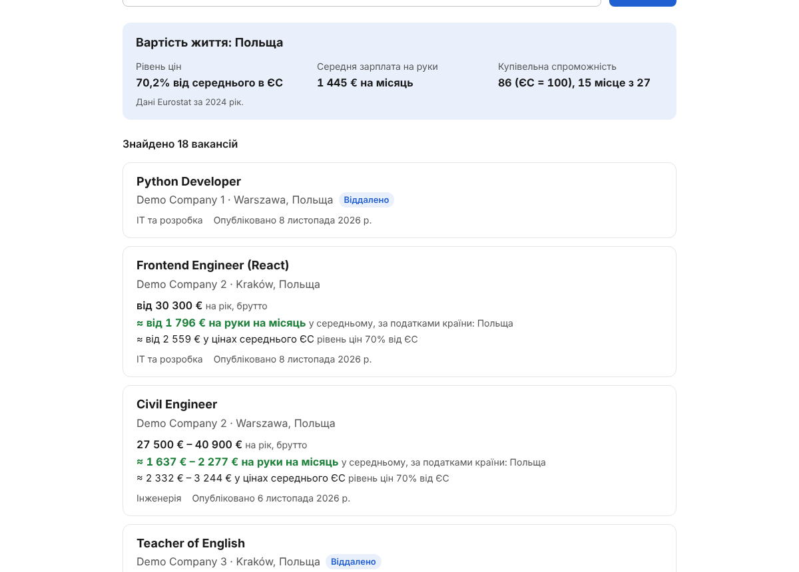
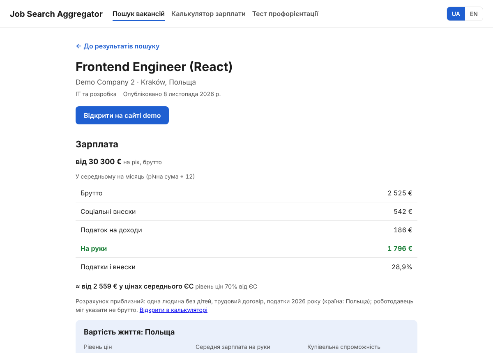
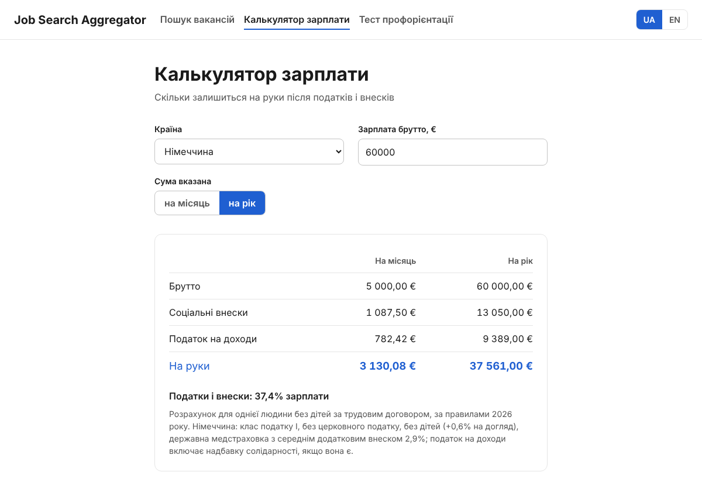
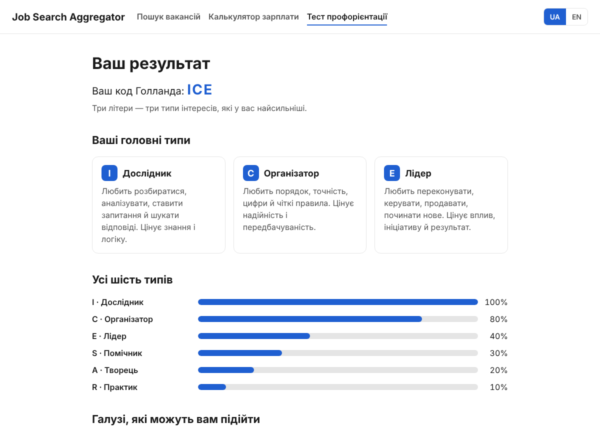
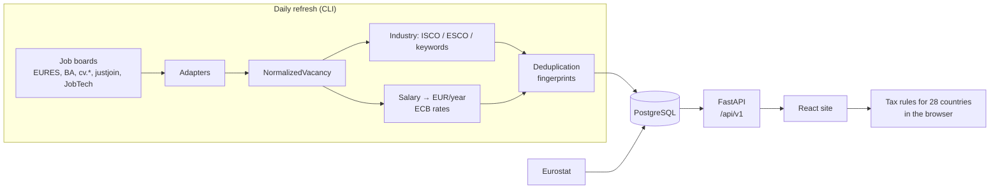

# Job Search Aggregator

**English** | [Русский](README.ru.md)

[](https://github.com/FRP61/Job-Search-Aggregator/actions/workflows/backend.yml)
[](https://github.com/FRP61/Job-Search-Aggregator/actions/workflows/frontend.yml)


Job search across all 27 EU countries that answers the question a plain job board doesn't:
**"How much will I actually have left after taxes, and what is that worth where I'd live?"**

Vacancies from seven job boards are collected into one database, cleaned of duplicates and shown with
the gross salary, the take-home pay under that country's 2026 tax rules and the cost of living.
A career test (RIASEC) helps people who don't yet know which industry to look in.

| Search | Vacancy |
|---|---|
|  |  |
| **Gross → net calculator** | **Career test result** |
|  |  |

## Why this project

Moving to another EU country, people compare offers in different currencies, pay periods and tax systems.
A €4,000 gross salary means very different money in Germany, Poland and Estonia, and the boards that list the
jobs don't help with that. The goal was one place that:

- searches several countries at once, with one industry list and one salary scale (euros per year);
- shows each job **once**, even when it is posted on several boards or in several countries;
- turns gross pay into take-home pay and compares it with local prices.

## Features

- **Search across 27 EU countries** by country, industry and keyword; the filters live in the URL, so a search can be shared.
- **7 sources:** EURES (all EU), Bundesagentur für Arbeit (DE), cv.ee / cv.lv / cvonline.lt (Baltics), justjoin.it (PL), JobTech (SE).
- **Deduplication** across boards and countries: a job listed in five countries is one card with five flags and links to its copies.
- **Industry detection:** first from ISCO/ESCO occupation codes, then from title keywords (including German compound words).
- **Salary normalisation:** any currency and pay period → euros per year, using daily ECB exchange rates.
- **Gross → net calculator** for 27 EU countries + Ukraine, 2026 rules: income tax, social contributions, tax-free allowances.
- **Cost-of-living index** from Eurostat: how much a local net salary buys compared with the EU average.
- **Career test:** 30 statements, Holland's RIASEC model, then three recommended industries with fresh vacancies.
- **Ukrainian and English** interface, accessible markup, mobile layout.

## Tech stack

| Part | Technologies |
|---|---|
| Backend | Python 3.12+, FastAPI, SQLAlchemy 2 (async), Alembic, Pydantic, httpx |
| Database | PostgreSQL 17 (SQLite for local runs and tests) |
| Frontend | React 19, React Router, i18next, Vite, CSS Modules, DOMPurify |
| Tests | pytest (387 tests), Vitest + React Testing Library (115 tests) |
| Infrastructure | Docker, docker compose, nginx, GitHub Actions |
| External data | EURES, Bundesagentur, cv.ee/lv/lt, justjoin.it, JobTech, ESCO, ECB, Eurostat |

## Architecture



Collecting and searching are separate on purpose: boards are slow and sometimes down, so search never
calls them. A refresh command fills the database, and the API answers from it in about 100–300 ms.

## Engineering highlights

- **Adapter per source.** Each board is one file that turns its data into a shared `NormalizedVacancy`. Adding a board doesn't touch the rest of the code.
- **Two-level duplicate detection.** A strict fingerprint (title, company, country, place) and a loose one without the place, because not every board gives a city. Copies from other boards are linked only if published within 3 days.
- **Not losing real jobs.** On the same board two postings count as one only if their descriptions also match. Checked on live data: in the Italian sample, skipped vacancies went down from 2,331 to 411 (staffing agencies post many similar jobs).
- **Resilient refresh.** One broken vacancy or a non-JSON maintenance page doesn't stop the run; temporary network errors are retried; ESCO lookups are cached for a year.
- **Tax rules as data + functions.** Each country is a separate module in `frontend/src/salary/rules/`, covered by tests with reference values.
- **Migrations are checked in CI** on real PostgreSQL: upgrade, compare with the models, seed, downgrade.

## Results on real data

A full refresh of every source and all 27 countries ([verification report](docs/VERIFICATION.md)):

| | |
|---|---|
| Vacancies collected | **119,476** in 27 of 27 countries |
| Duration / crashes | 137 minutes / 0 |
| Search time (~119k rows) | 67–283 ms |
| Bugs found by the run and fixed | 4, each with evidence and a rerun |

## How it was built

The work went in feature branches, one area at a time, each with its own tests.

| Dates (2026) | Stage |
|---|---|
| Oct 31 | Backend skeleton: FastAPI, DB schema, 27 countries, 19 industries; Eurostat cost-of-living index |
| Oct 31 – Nov 2 | Data core: salary → EUR/year, title and company normalisation, fingerprints, industry classification |
| Nov 2 | Frontend scaffold, header, UA/EN switcher |
| Nov 2 – 4 | EURES integration, saving without duplicates, search API, Bundesagentur, ESCO, cv.ee/lv/lt, justjoin.it, JobTech, ECB rates |
| Nov 4 | Full refresh on real data, verification report, fixes for the bugs it found |
| Nov 6 – 8 | Salary calculator (Estonia first, then all 27 EU countries + Ukraine) |
| Nov 8 | Search page, vacancy cards, career test, recommendations, accessibility, 404, Docker, CI; backend and frontend combined |

The full history is in the branches: `feature/backend-setup` → `feature/cost-of-living` → `feature/job-integrations`
and `feature/frontend-setup` → `feature/salary-calculator` → … → `feature/polish` → `full-site`.

## Author

**[SatohyNo](https://github.com/SatohyNo)** — the whole project: idea, requirements, architecture,
backend and data pipeline, frontend, tax rules, testing on real data and documentation.

The code was written with an AI coding assistant (Claude). Requirements, design decisions, review of every
change and checks on real data are mine; that's why some commits carry `Co-Authored-By` lines.

## Run it

### Without Docker

Needs **Python 3.12+** and **Node.js 22.12+**. The first run installs everything (a few minutes).

| | Windows | macOS / Linux |
|---|---|---|
| Start the site | double-click `run-site.bat` | `./run-site.sh` |
| Load vacancies | double-click `load-vacancies.bat` | `./run-site.sh load` |

The site opens at http://localhost:5173, the API docs at http://localhost:8000/docs. Data is stored in `backend/jobs.db` (SQLite).

### With Docker

```bash
docker compose up --build
```

```bash
docker compose exec backend python -m app.cli refresh-source cv_lv
```

The site is at http://localhost:3000. Sources for `refresh-source`: `cv_lv`, `cv_ee`, `cv_lt`, `justjoin`, `bundesagentur`, `jobtech`.

### Tests

```bash
cd backend && pytest
```

```bash
cd frontend && npm test -- --run
```

## Documentation

- [backend/README.md](backend/README.md) — API endpoints, vacancy refresh, cost-of-living formula
- [frontend/README.md](frontend/README.md) — pages, settings, deploy
- [docs/BACKEND.md](docs/BACKEND.md) — every module of the backend and why it's built that way
- [docs/VERIFICATION.md](docs/VERIFICATION.md) — full run on real data, bugs found, open questions
- [docs/PUBLIC_RELEASE.md](docs/PUBLIC_RELEASE.md) — checklist before going public

## Limitations and next steps

- Vacancies come only from free public sources; large countries are read partly per run (page limits), daily runs accumulate them.
- Salaries are listed in a minority of vacancies (about 7.5k of 119k).
- The tax calculator covers a typical employee: no family allowances, church tax and other special cases.
- Next: scheduled refresh in production, a deployed demo, saved searches and email alerts.

Vacancy texts belong to the job boards and employers; the project only links to the originals.
