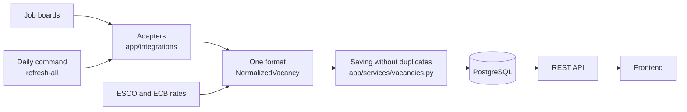

# Job Search Aggregator

**English** | [Русский](README.ru.md)

Job search across all 27 EU countries in one place. The service collects vacancies from public employment
services and large job boards, brings them to one format, removes duplicates and adds context: the salary
in euros per year and a cost-of-living comparison between countries.

**Backend author:** [SatohyNo](https://github.com/SatohyNo)

**Status:** the backend is ready to be merged with the frontend. The service isn't deployed yet.

## What the backend does

- **Collects vacancies** from sources that need no access key: one EU-wide portal and several national boards.
- **Shows only what's current:** vacancies published in the last 30 days. Vacancies without a date are dropped.
- **Searches** by one or several countries or none at all, by industry and by a word in the title or company.
- **Removes duplicates:** the same vacancy from another board becomes a link on the main record, and a vacancy listed in several countries appears once with a list of countries.
- **Finds the industry** the same way across languages: from international ISCO/ESCO occupation codes or the board's categories, and from words in the title when there are none.
- **Converts salaries** to euros per year using European Central Bank rates.
- **Compares the cost of living:** a purchasing power index based on Eurostat data.

## How it works



Search reads our own database and doesn't contact the boards during a request. So the response doesn't depend
on outside services, and vacancies are as fresh as the last refresh.

## Job sources

| Source | Countries | What it adds to the basic fields |
|---|---|---|
| [EURES](https://europa.eu/eures) | all 27 | occupation codes, region |
| Bundesagentur für Arbeit | DE | city |
| cv.ee, cv.lv, cvonline.lt | EE, LV, LT | salary, board category |
| justjoin.it | PL | salary, city (IT jobs) |
| JobTech (Arbetsförmedlingen) | SE | city, full description, industry |

Data comes only from APIs that answer without bypassing any protection. Sites with anti-bot protection aren't
used, and HTML pages aren't parsed.

Supporting services: [ESCO](https://esco.ec.europa.eu) (occupation codes), ECB (exchange rates), Eurostat (cost of living).

## Tech stack

Python 3.12+, FastAPI, SQLAlchemy 2 (async), PostgreSQL, Alembic, httpx, pytest, respx, Docker, GitHub Actions.
CI runs the migrations and tests on real PostgreSQL.

## Quick start

```bash
docker compose up --build
```

The API and its documentation will be at http://localhost:8000/docs. To load vacancies:

```bash
docker compose exec backend python -m app.cli refresh-source cv_lv
```

Running without Docker, all commands and the API response format: [backend/README.md](backend/README.md).
Full code description, with what each file does, its functions, parameters and reasons: [docs/BACKEND.md](docs/BACKEND.md).

## API

Base path: `/api/v1`.

| Method | Path | Description |
|---|---|---|
| GET | `/vacancies` | search: `country`, `industry`, `q`, `page`, `page_size` |
| GET | `/vacancies/{id}` | one vacancy with its full description |
| GET | `/countries` | the 27 EU countries |
| GET | `/industries` | industries |
| GET | `/cost-of-living` | countries ranked by purchasing power |
| GET | `/cost-of-living/{code}` | a country's index and history |
| GET | `/health` | status of the service and database |

Example: `/api/v1/vacancies?country=PL&country=GR&industry=it&q=python`

## Project structure

```
backend/
  app/
    api/routes/     endpoints
    integrations/   source adapters, ESCO, ECB rates
    services/       salaries, industries, duplicates, saving, cache
    data/           reference data: countries, industries, ISCO mapping
    models.py       database tables
    schemas.py      API response formats
    cli.py          data refresh commands
  alembic/          migrations
  tests/            tests
docs/               backend description, verification report, checklist for going public
docker-compose.yml  local run
```

## What is responsible for what

The path of one vacancy through the code:

| Step | What happens | Where in the code |
|---|---|---|
| 1. Start | The daily command starts a refresh | `app/cli.py`, `refresh_all` |
| 2. Download | An adapter reads the board page by page | `app/integrations/*.py`, `collect_pages` |
| 3. Common format | The board's data becomes a `NormalizedVacancy` | `parse_*_job` in the adapters |
| 4. Date check | Vacancies without a date or older than 30 days are dropped | `parse_*_response`, `is_too_old` |
| 5. Industry | Occupation codes, the board's category, or words in the title | `app/services/classify.py`, `app/integrations/esco.py` |
| 6. Fingerprint | A "signature" of the vacancy is computed to find duplicates | `app/services/normalize.py`, `fill_computed_fields` |
| 7. Salary | The amount is converted to euros per year | `app/services/salary.py`, `app/integrations/ecb.py` |
| 8. Saving | New, update, link or duplicate | `app/services/vacancies.py`, `save_vacancies` |
| 9. Search | The user gets the result from the database | `app/api/routes/vacancies.py` |

Each function and its parameters are described in [docs/BACKEND.md](docs/BACKEND.md).

## Decisions and why they were made

### Architecture

| Decision | Why | Trade-off |
|---|---|---|
| **Search reads our own database, not the boards** | Boards are slow and can fail. Users shouldn't wait for them | Vacancies are only as fresh as the last refresh |
| **Each board is a separate adapter with one output format** | A new board is one file, and the rest of the code doesn't notice | Each board needs its own parsing code |
| **Logic is separate from HTTP and the network** | Rules can be tested without internet | More files |
| **Asynchronous code (`async/await`)** | The program mostly waits for the network or database, and this waiting doesn't block other work | The code is harder than plain synchronous code |
| **PostgreSQL and Alembic migrations** | Reliable constraints in the database, and the schema can be recreated on any machine | Needs a separate database server |
| **Shared `collect_pages` loop** | Pauses, limits and failure handling are the same for every board and written once | Adapters pass functions into it, which is harder for a beginner to read |

### Sources

| Decision | Why | Trade-off |
|---|---|---|
| **EURES as the base** | One portal covers the public services of all 27 countries without a key | Its search response has no city or salary |
| **APIs only, no HTML parsing or anti-bot bypassing** | More stable, and bypassing protection breaks the sites' rules | Some large sites are unavailable |
| **National boards on top of EURES** | They give what EURES lacks: city, salary, categories | Duplicates appear and must be merged |
| **Bundesagentur, justjoin.it, cv.\*, JobTech connected** | Data, limits and links were checked on real responses | Page limits prevent reading everything at once |
| **nofluffjobs and Työmarkkinatori postponed** | The first returns the same page for any number, and links from the second couldn't be confirmed | Less first-hand data for Poland and Finland |
| **Page limits set by testing:** EURES 200, Bundesagentur 100 | A page past the limit answers with error 400 | Only part of a large country's vacancies per run |
| **A minimal 0.2 s pause between requests** | Avoids overloading other services without stretching the refresh too much | A full refresh takes a long time |
| **A failed country or page doesn't stop the rest** | Occasional failures are unavoidable in a long download. What was already read is kept | Data can be incomplete, and only the summary and log show it |

### The 30-day rule

| Decision | Why | Trade-off |
|---|---|---|
| **Only vacancies from the last 30 days are shown** | Older vacancies are mostly no longer relevant | A "month" is exactly 30 days, not a calendar month |
| **The date is required, and a vacancy without one is dropped** | There's no way to confirm it's recent | Vacancies from boards that omit the date are lost |
| **The date is also checked in our code** | The EURES filter let through 90-day-old vacancies. Judging by its responses, it looks at the modification date, not the publication date | Part of what's downloaded is discarded |
| **The rule also applies during search** | Vacancies in the database age, so checking at download isn't enough | Old rows stay in the database, since nothing deletes them yet |

### Duplicates

| Decision | Why | Trade-off |
|---|---|---|
| **A fingerprint of title, company, country and place** | The same job has different ids on different boards, so the content is compared | Different spelling of a title gives different fingerprints |
| **One row per country, shown once with a `countries` list** | EURES lists one job in several countries, and search by country must find it. Repeats would clutter the full list | The search query is more complex because of grouping |
| **A copy from another board becomes a link in `other_sources`** | The user sees one card, and the other board isn't lost | The link is stored only on the row of its own country |
| **A record takes only one copy from each board** | A real run hid 132 branches of one chain behind one card | Real copies beyond the first stay as separate cards |
| **A second fingerprint without the place** | EURES has no city, so the normal fingerprint can't find its Bundesagentur copies | False matches are possible, hence the next rule |
| **It's a copy only if the dates are within 3 days** | Testing showed that jobs from different branches of an employer got merged, though they were months apart | Branches published together can still merge. 3 days is an estimate |
| **The region code counts as the place for EURES** | Without it, jobs from different regions counted as duplicates and got lost | One job posted in different regions gives several rows |
| **Without a company, a vacancy matches only itself** | Two employers can both look for a cook, so a title alone proves nothing | Duplicates are possible. An extra card is better than a lost vacancy |
| **A repost takes over an expired row** | Otherwise a fresh job counted as a duplicate of an old one that search no longer shows, and disappeared | Old links in `other_sources` can remain |

### Industries

| Decision | Why | Trade-off |
|---|---|---|
| **Order: ISCO/ESCO codes or the board's category, then words in the title** | Codes are the same in every language. With title words alone, 83% of EURES vacancies fell into `other` | Needs extra requests to ESCO |
| **Our own ISCO → industry table** | No official mapping to our industries exists | The table is our judgement, and some cases are debatable |
| **ISCO describes the occupation, not the employer** | For job search, what the person will do matters more: a secretary in a hospital is administration | The employer's sector is ignored |
| **ESCO answers are cached for a year** | A request takes over a second, and occupations rarely change | The first run is much longer |
| **An ESCO failure doesn't stop the refresh, and one failing link doesn't stop the others** | Some links always answer with error 500 and blocked every link after them. Lookups stop only after 3 failures in a row | Some vacancies keep the industry guessed from the title |
| **"Part of a word" keywords for German** | Compound words like `Bilanzbuchhalter` weren't found by the word's start | False matches are a risk, so `*fahrer*` isn't used: it's inside `Erfahrener` |

### Salaries

| Decision | Why | Trade-off |
|---|---|---|
| **One scale: euros per year** | The only way to compare an hourly rate in złoty with a monthly one in euros | The conversion is approximate: 2080 hours, 220 days a year |
| **ECB rates cached for a day** | An official source, updated once per working day | Without rates, only amounts in euros are converted |
| **The real rate from justjoin.it (`fromPerUnit`)** | `from` is already scaled to a month, and a real test gave over 5 million euros a year | Depends on the board's internal format |
| **Yearly salaries outside 1,000–1,000,000 euros aren't shown** | Source errors gave 9 million a year and 79 euros a year. The board's own figures stay in the row | A real but unusual amount would be hidden too |
| **The amount in the employer's currency** | The board adds its own conversions, and we convert everything with one source of rates | None |

### Reliability

| Decision | Why | Trade-off |
|---|---|---|
| **A broken vacancy is skipped** | One bad record shouldn't stop a download | A real parsing bug also looks like a skipped vacancy |
| **A temporary failure is retried once** | A dropped connection stopped Bundesagentur at page 42 of 100 | Failures wait a little longer |
| **A non-JSON answer counts as a failed request** | A site can return a maintenance page with status 200 | None |
| **Saving in batches of 1000** | One database query has a limit on the number of values | Slightly more queries |
| **Tests on samples of real responses, without network** | Fast, stable, and they don't load other services | They won't notice a site changing its format, which takes real runs |
| **CI on real PostgreSQL** | Local SQLite behaves differently, for example it doesn't limit string length | Slower to run |
| **New sources and large changes are checked on real data** | This found bugs the tests missed: salaries, the `EL` code for Greece, outdated API documentation | Needs access to the services, and time |

## Limitations

What to know before using the data:

- **Boards return a limited number of pages**, so one run doesn't see all vacancies of large countries. Daily refreshes accumulate them over 30 days.
- **Salaries aren't everywhere** and aren't always comparable: justjoin.it mixes B2B and employment, and gross or net isn't always stated. Implausible amounts occur in the source data.
- **The industry is approximate**, especially when only title words are left.
- **Merging duplicates isn't perfect:** a branch of one company published the same day can merge with a copy from another board, though a record takes only one copy per board. Vacancies counted as duplicates aren't all proven to be duplicates: see the report.
- **The service hasn't run in production.** A full refresh hasn't been run on PostgreSQL: the CI tests use PostgreSQL, and the full run was on SQLite. Results: [docs/VERIFICATION.md](docs/VERIFICATION.md).

## Next steps

- Frontend.
- Deployment and a daily `refresh-all`.
- Sources with access keys: Adzuna, France Travail, InfoJobs.
- Net salary calculator.
