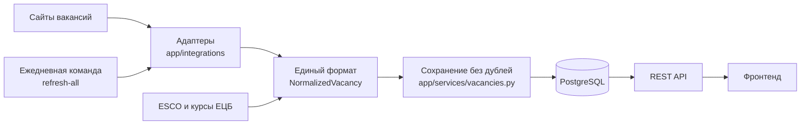

# Job Search Aggregator

[English](README.md) | **Русский**

Поиск вакансий по всем 27 странам ЕС в одном месте. Сервис собирает вакансии из государственных служб занятости
и крупных сайтов, приводит их к одному формату, убирает дубли и добавляет контекст: зарплату в евро за год
и сравнение стоимости жизни между странами.

**Автор бекенда:** [SatohyNo](https://github.com/SatohyNo)

**Статус:** бекенд готов к объединению с фронтендом, сервис ещё не развёрнут.

## Что умеет бекенд

- **Собирает вакансии** из источников без ключей доступа: один общеевропейский портал и несколько национальных сайтов.
- **Показывает только актуальное:** вакансии, опубликованные за последние 30 дней. Вакансии без даты отсеиваются.
- **Ищет** по одной или нескольким странам либо без привязки к стране, по отрасли и слову в названии или компании.
- **Убирает дубли:** та же вакансия с другого сайта становится ссылкой на основную запись, а вакансия из нескольких стран показывается один раз со списком стран.
- **Определяет отрасль** одинаково для разных языков: по международным кодам профессий ISCO/ESCO или категориям сайта, а если их нет, по словам в названии.
- **Пересчитывает зарплаты** в евро за год по курсам Европейского центрального банка.
- **Сравнивает стоимость жизни:** индекс покупательной способности по данным Eurostat.

## Как это работает



Поиск читает собственную базу и не обращается к сайтам во время запроса. Поэтому ответ не зависит от чужих
сервисов, а вакансии свежие на момент последнего обновления.

## Источники вакансий

| Источник | Страны | Что даёт сверх базовых полей |
|---|---|---|
| [EURES](https://europa.eu/eures) | все 27 | коды профессий, регион |
| Bundesagentur für Arbeit | DE | город |
| cv.ee, cv.lv, cvonline.lt | EE, LV, LT | зарплата, категория сайта |
| justjoin.it | PL | зарплата, город (IT-вакансии) |
| JobTech (Arbetsförmedlingen) | SE | город, полное описание, отрасль |

Данные берутся только через API, которые отвечают без обхода защиты. Сайты с антиботом не используются,
разбора HTML-страниц нет.

Дополнительные сервисы: [ESCO](https://esco.ec.europa.eu) (коды профессий), ЕЦБ (курсы валют), Eurostat (стоимость жизни).

## Технологии

Python 3.12+, FastAPI, SQLAlchemy 2 (async), PostgreSQL, Alembic, httpx, pytest, respx, Docker, GitHub Actions.
CI запускает миграции и тесты на настоящем PostgreSQL.

## Быстрый старт

```bash
docker compose up --build
```

API и его документация будут на http://localhost:8000/docs. Загрузить вакансии:

```bash
docker compose exec backend python -m app.cli refresh-source cv_lv
```

Запуск без Docker, все команды и формат ответа API: [backend/README.ru.md](backend/README.ru.md).
Полное описание кода, что делает каждый файл, его функции, параметры и причины решений: [docs/BACKEND.ru.md](docs/BACKEND.ru.md).

## API

Базовый путь: `/api/v1`.

| Метод | Путь | Описание |
|---|---|---|
| GET | `/vacancies` | поиск: `country`, `industry`, `q`, `page`, `page_size` |
| GET | `/vacancies/{id}` | одна вакансия с полным описанием |
| GET | `/countries` | 27 стран ЕС |
| GET | `/industries` | отрасли |
| GET | `/cost-of-living` | рейтинг стран по покупательной способности |
| GET | `/cost-of-living/{code}` | индекс страны и история |
| GET | `/health` | состояние сервиса и базы |

Пример: `/api/v1/vacancies?country=PL&country=GR&industry=it&q=python`

## Структура

```
backend/
  app/
    api/routes/     эндпоинты
    integrations/   адаптеры источников, ESCO, курсы ЕЦБ
    services/       зарплаты, отрасли, дубли, сохранение, кэш
    data/           справочники: страны, отрасли, соответствие кодов ISCO
    models.py       таблицы базы
    schemas.py      форматы ответов API
    cli.py          команды обновления данных
  alembic/          миграции
  tests/            тесты
docs/               описание бекенда, отчёт о проверке, чек-лист для публичной версии
docker-compose.yml  локальный запуск
```

## Что за что отвечает

Путь одной вакансии через код:

| Шаг | Что происходит | Где в коде |
|---|---|---|
| 1. Запуск | Ежедневная команда запускает обновление | `app/cli.py`, `refresh_all` |
| 2. Загрузка | Адаптер читает сайт страница за страницей | `app/integrations/*.py`, `collect_pages` |
| 3. Общий формат | Данные сайта становятся `NormalizedVacancy` | `parse_*_job` в адаптерах |
| 4. Проверка даты | Вакансии без даты или старше 30 дней отсеиваются | `parse_*_response`, `is_too_old` |
| 5. Отрасль | Коды профессий, категория сайта или слова в названии | `app/services/classify.py`, `app/integrations/esco.py` |
| 6. Отпечаток | Считается «подпись» вакансии для поиска дублей | `app/services/normalize.py`, `fill_computed_fields` |
| 7. Зарплата | Сумма переводится в евро за год | `app/services/salary.py`, `app/integrations/ecb.py` |
| 8. Сохранение | Новая, обновление, ссылка или дубль | `app/services/vacancies.py`, `save_vacancies` |
| 9. Поиск | Пользователь получает результат из базы | `app/api/routes/vacancies.py` |

Каждая функция и её параметры описаны в [docs/BACKEND.ru.md](docs/BACKEND.ru.md).

## Решения и почему они приняты

### Архитектура

| Решение | Почему | Цена решения |
|---|---|---|
| **Поиск читает свою базу, а не сайты** | Сайты медленные и могут не отвечать. Пользователь не должен их ждать | Вакансии свежие только на момент последнего обновления |
| **Каждый сайт — отдельный адаптер, а на выходе один формат** | Новый сайт добавляется одним файлом, остальной код его не замечает | Для каждого сайта нужен свой код разбора |
| **Логика отдельно от HTTP и сети** | Правила можно проверять тестами без интернета | Больше файлов |
| **Асинхронный код (`async/await`)** | Программа почти всё время ждёт сеть или базу, и это ожидание не блокирует другую работу | Код сложнее обычного |
| **PostgreSQL и миграции Alembic** | Надёжные ограничения на уровне базы, а схему можно воссоздать на любой машине | Нужен отдельный сервер базы |
| **Общий цикл `collect_pages`** | Паузы, лимиты и обработка сбоев одинаковы для всех сайтов и пишутся один раз | Адаптеры передают в него функции, новичку это читать сложнее |

### Источники

| Решение | Почему | Цена решения |
|---|---|---|
| **EURES как основа** | Один портал покрывает государственные службы всех 27 стран без ключа | В его поисковом ответе нет города и зарплаты |
| **Только API, без разбора HTML и обхода антиботов** | Это стабильнее, а обход защиты нарушает правила сайтов | Часть крупных сайтов недоступна |
| **Национальные сайты в дополнение к EURES** | Дают то, чего нет в EURES: город, зарплату, категории | Появляются дубли, которые надо склеивать |
| **Подключены Bundesagentur, justjoin.it, cv.\*, JobTech** | Данные, лимиты и ссылки проверены на реальных ответах | Лимиты страниц не дают прочитать всё за раз |
| **nofluffjobs и Työmarkkinatori отложены** | Первый возвращает одну и ту же страницу при любом номере, а ссылки второго подтвердить не удалось | Меньше данных из первоисточника по Польше и Финляндии |
| **Лимиты страниц по факту:** EURES 200, Bundesagentur 100 | Страница за лимитом даёт ошибку 400 | Только часть вакансий крупных стран за один запуск |
| **Минимальная пауза 0,2 с между запросами** | Чтобы не перегружать чужие сервисы и не растягивать обновление | Полное обновление идёт долго |
| **Сбой одной страны или страницы не останавливает остальные** | При долгой загрузке отдельные сбои неизбежны. Уже прочитанное сохраняется | Данные могут быть неполными, и видно это только в итогах и журнале |

### Правило 30 дней

| Решение | Почему | Цена решения |
|---|---|---|
| **Показываем только вакансии за 30 дней** | Старые вакансии в основном уже неактуальны | «Месяц» — это ровно 30 дней, а не календарный месяц |
| **Дата обязательна, без неё вакансия отсеивается** | Нельзя подтвердить, что вакансия свежая | Теряются вакансии сайтов, где нет даты |
| **Дата проверяется и в нашем коде** | Фильтр EURES пропускал вакансии возрастом 90 дней: судя по ответам, он смотрит на дату изменения, а не публикации | Часть загруженного отбрасывается |
| **Правило действует и при поиске** | Вакансии в базе стареют, поэтому проверки при загрузке недостаточно | Старые строки остаются в базе, пока их никто не удаляет |

### Дубли

| Решение | Почему | Цена решения |
|---|---|---|
| **Отпечаток из названия, компании, страны и места** | У одной вакансии на разных сайтах разные id, поэтому сравнивается содержимое | Разное написание названия даёт разные отпечатки |
| **Отдельная строка на страну, а показ один раз со списком `countries`** | EURES даёт одну вакансию в нескольких странах, а поиск по стране должен её находить. В общем списке повторы мешали бы | Запрос поиска сложнее из-за группировки |
| **Копия с другого сайта становится ссылкой в `other_sources`** | Пользователь видит одну карточку, а другой сайт не теряется | Ссылка хранится только на строке своей страны |
| **Запись принимает только одну копию с каждого сайта** | В реальном прогоне 132 филиала одной сети спрятались за одной карточкой | Настоящие копии сверх первой остаются отдельными карточками |
| **Второй отпечаток без места** | У EURES нет города, поэтому обычный отпечаток не находит его копии из Bundesagentur | Возможны ложные совпадения, поэтому есть правило ниже |
| **Копия, только если даты в пределах 3 дней** | Проверка показала: вакансии разных филиалов одного работодателя склеивались, хотя их разделяли месяцы | Филиалы, опубликованные вместе, всё ещё могут склеиться. Порог 3 дня — это оценка |
| **Код региона считается местом для EURES** | Без него вакансии из разных регионов считались дублями и терялись | Одна вакансия в разных регионах даст несколько строк |
| **Без компании вакансия совпадает только сама с собой** | Два работодателя могут искать повара, одно название ничего не доказывает | Возможны дубли. Лучше лишняя карточка, чем потерянная вакансия |
| **Новая публикация занимает строку просроченной** | Иначе свежая вакансия считалась дублем старой, которую поиск уже не показывает, и исчезала | Старые ссылки в `other_sources` могут остаться |

### Отрасли

| Решение | Почему | Цена решения |
|---|---|---|
| **Порядок: коды ISCO/ESCO или категория сайта, затем слова в названии** | Коды одинаковы на всех языках. Только по словам в названии в `other` попадало 83% вакансий EURES | Нужны дополнительные запросы к ESCO |
| **Своя таблица ISCO → отрасль** | Официального соответствия нашим отраслям нет | Таблица — это наше суждение, бывают спорные случаи |
| **ISCO описывает профессию, а не работодателя** | Для поиска работы важнее, что человек будет делать: секретарь в больнице — это администрирование | Отрасль работодателя не учитывается |
| **Кэш ответов ESCO на год** | Запрос идёт больше секунды, а профессии меняются редко | Первый запуск заметно дольше |
| **Сбой ESCO не останавливает обновление, а одна сломанная ссылка не останавливает остальные** | Некоторые ссылки всегда отвечают ошибкой 500 и блокировали все ссылки после них. Запросы останавливаются только после 3 сбоев подряд | Часть вакансий остаётся с отраслью по названию |
| **Ключевые слова «часть слова» для немецкого** | Составные слова вроде `Bilanzbuchhalter` не находились по началу слова | Есть риск ложных совпадений, поэтому `*fahrer*` не добавлен: он есть в `Erfahrener` |

### Зарплаты

| Решение | Почему | Цена решения |
|---|---|---|
| **Единая шкала: евро за год** | Только так можно сравнить часовую ставку в злотых и месячную в евро | Пересчёт приблизительный: 2080 часов, 220 дней в году |
| **Курсы ЕЦБ с кэшем на день** | Официальный источник, обновляется раз в рабочий день | Без курсов считаются только суммы в евро |
| **Настоящая ставка justjoin.it (`fromPerUnit`)** | Поле `from` уже пересчитано в месяц, и в реальной проверке вышло больше 5 млн евро в год | Зависим от внутреннего формата сайта |
| **Годовые зарплаты вне диапазона 1 000–1 000 000 евро не показываются** | Ошибки источников давали 9 млн в год и 79 евро в год. Исходные цифры сайта остаются в строке | Настоящая, но необычная сумма тоже будет скрыта |
| **Берём сумму в валюте работодателя** | Сайт добавляет свои пересчёты, а мы считаем всё по одному источнику курсов | Нет |

### Надёжность

| Решение | Почему | Цена решения |
|---|---|---|
| **Сломанная вакансия пропускается** | Одна плохая запись не должна останавливать загрузку | Настоящая ошибка разбора тоже будет выглядеть как пропущенная вакансия |
| **Временный сбой повторяется один раз** | Обрыв соединения останавливал Bundesagentur на странице 42 из 100 | При сбоях ждём чуть дольше |
| **Ответ не в JSON считается сбоем запроса** | Сайт может отдать страницу техработ со статусом 200 | Нет |
| **Сохранение частями по 1000** | У одного запроса к базе есть ограничение на число значений | Чуть больше запросов |
| **Тесты на примерах реальных ответов, без сети** | Быстрые, стабильные и не нагружают чужие сервисы | Не заметят смену формата на сайте, для этого нужны реальные прогоны |
| **CI на настоящем PostgreSQL** | Локальный SQLite ведёт себя иначе, например не ограничивает длину строк | Запуск медленнее |
| **Новые источники и большие изменения проверяются на реальных данных** | Это нашло ошибки, которые пропустили тесты: зарплаты, код Греции `EL`, устаревшую документацию API | Нужны доступ к сервисам и время |

## Ограничения

Что стоит знать перед использованием данных:

- **Сайты отдают ограниченное число страниц**, поэтому один запуск не видит всех вакансий крупных стран. Ежедневные обновления накапливают их за 30 дней.
- **Зарплата есть не везде** и не всегда сравнима: в justjoin.it смешаны B2B и работа по найму, а брутто или нетто указано не всегда. Встречаются неправдоподобные суммы из исходных данных.
- **Отрасль определена приблизительно**, особенно когда остаются только слова в названии.
- **Склейка дублей неидеальна:** филиал компании, опубликованный в тот же день, может склеиться с копией с другого сайта, хотя запись принимает только одну копию с каждого сайта. Не все вакансии, посчитанные дублями, доказанно дубли: подробности в отчёте.
- **Сервис ещё не работал в продакшене.** Полное обновление на PostgreSQL не запускалось: тесты в CI идут на PostgreSQL, а полный прогон был на SQLite. Результаты: [docs/VERIFICATION.ru.md](docs/VERIFICATION.ru.md).

## Следующие шаги

- Фронтенд.
- Развёртывание и ежедневный запуск `refresh-all`.
- Источники с ключами доступа: Adzuna, France Travail, InfoJobs.
- Калькулятор чистой зарплаты.
