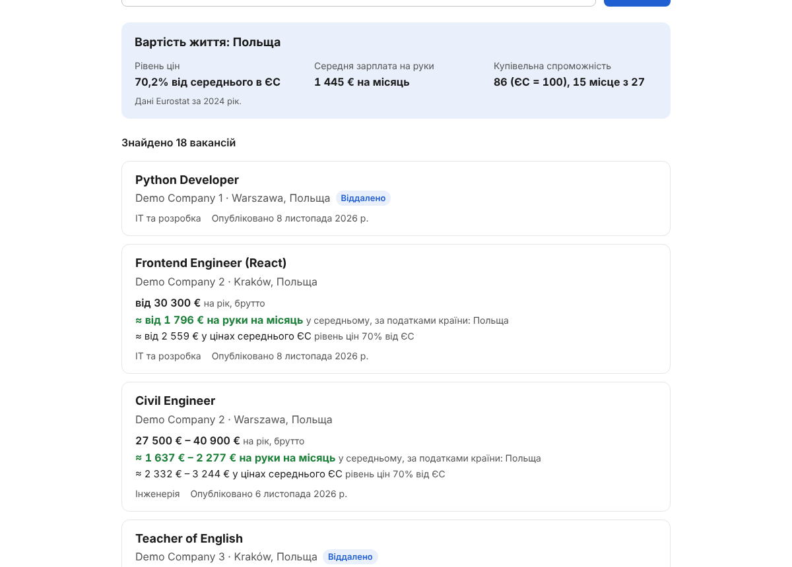
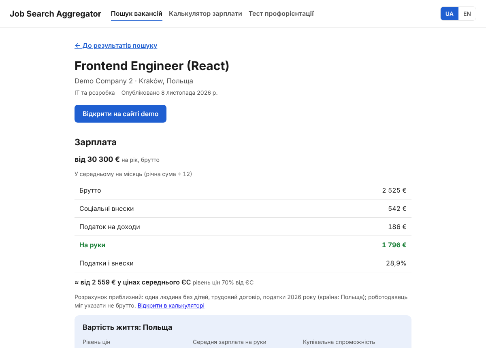
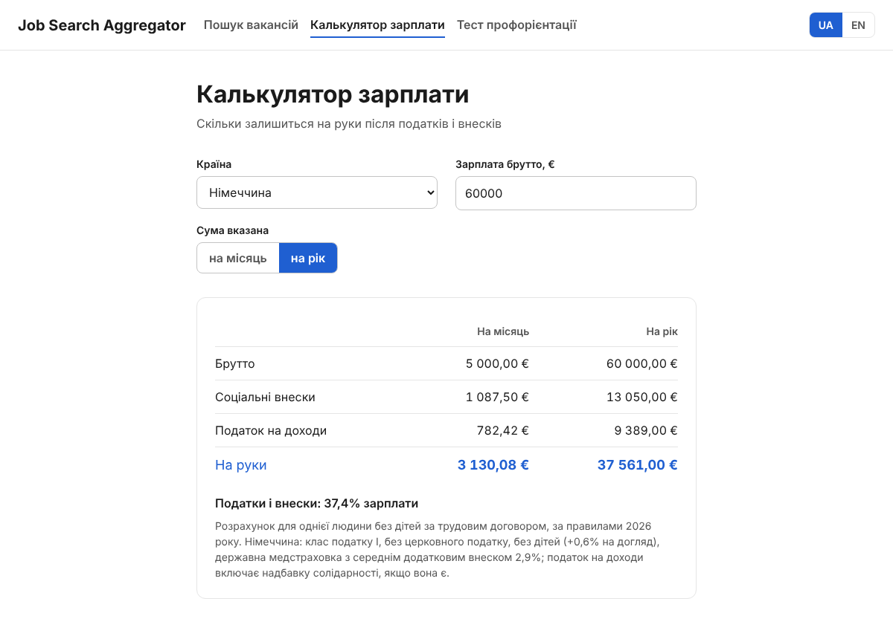
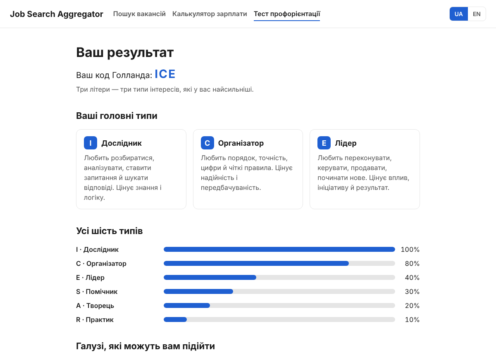
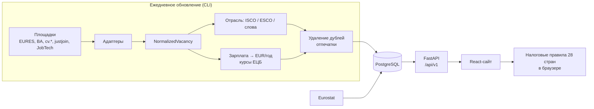

# Job Search Aggregator

[English](README.md) | **Русский**

[](https://github.com/FRP61/Job-Search-Aggregator/actions/workflows/backend.yml)
[](https://github.com/FRP61/Job-Search-Aggregator/actions/workflows/frontend.yml)


Поиск вакансий по всем 27 странам ЕС, который отвечает на вопрос, на который обычный сайт вакансий не отвечает:
**«Сколько я реально получу на руки и сколько это стоит там, где я буду жить?»**

Вакансии с семи площадок собираются в одну базу, очищаются от дублей и показываются с зарплатой брутто,
суммой на руки по налоговым правилам страны на 2026 год и стоимостью жизни. Тест профориентации (RIASEC)
помогает тем, кто ещё не знает, в какой отрасли искать.

| Поиск | Вакансия |
|---|---|
|  |  |
| **Калькулятор брутто → на руки** | **Результат теста** |
|  |  |

## Зачем этот проект

При переезде в другую страну ЕС люди сравнивают предложения в разных валютах, за разные периоды и при разных
налогах. 4000 € брутто — это очень разные деньги в Германии, Польше и Эстонии, а сайты с вакансиями с этим не
помогают. Цель — одно место, которое:

- ищет сразу по нескольким странам, с единым списком отраслей и единой шкалой зарплат (евро в год);
- показывает вакансию **один раз**, даже если она опубликована на нескольких площадках или в нескольких странах;
- переводит брутто в «на руки» и сравнивает с местными ценами.

## Возможности

- **Поиск по 27 странам ЕС** по стране, отрасли и ключевому слову; фильтры хранятся в адресе, поиском можно поделиться.
- **7 источников:** EURES (весь ЕС), Bundesagentur für Arbeit (DE), cv.ee / cv.lv / cvonline.lt (Балтия), justjoin.it (PL), JobTech (SE).
- **Удаление дублей** между площадками и странами: вакансия в пяти странах — одна карточка с пятью флагами и ссылками на копии.
- **Определение отрасли:** сначала по кодам профессий ISCO/ESCO, потом по словам в названии (включая немецкие составные слова).
- **Нормализация зарплат:** любая валюта и период → евро в год по ежедневным курсам ЕЦБ.
- **Калькулятор брутто → на руки** для 27 стран ЕС и Украины, правила 2026 года: подоходный налог, соцвзносы, необлагаемый минимум.
- **Индекс стоимости жизни** по данным Eurostat: сколько можно купить на местную зарплату по сравнению со средним по ЕС.
- **Тест профориентации:** 30 утверждений, модель RIASEC (Холланд), затем три подходящие отрасли со свежими вакансиями.
- Интерфейс на **украинском и английском**, доступная вёрстка, мобильная версия.

## Стек

| Часть | Технологии |
|---|---|
| Backend | Python 3.12+, FastAPI, SQLAlchemy 2 (async), Alembic, Pydantic, httpx |
| База данных | PostgreSQL 17 (SQLite для локального запуска и тестов) |
| Frontend | React 19, React Router, i18next, Vite, CSS Modules, DOMPurify |
| Тесты | pytest (387 тестов), Vitest + React Testing Library (115 тестов) |
| Инфраструктура | Docker, docker compose, nginx, GitHub Actions |
| Внешние данные | EURES, Bundesagentur, cv.ee/lv/lt, justjoin.it, JobTech, ESCO, ЕЦБ, Eurostat |

## Архитектура



Сбор и поиск разделены намеренно: площадки медленные и иногда падают, поэтому поиск к ним не обращается.
Команда обновления заполняет базу, а API отвечает из неё за 100–300 мс.

## Инженерные решения

- **Отдельный адаптер на каждый источник.** Каждая площадка — один файл, который переводит её данные в общий `NormalizedVacancy`. Новая площадка не меняет остальной код.
- **Двухуровневый поиск дублей.** Строгий отпечаток (название, компания, страна, место) и мягкий без места, потому что не каждая площадка даёт город. Копии с других площадок связываются, только если опубликованы в пределах 3 дней.
- **Не терять живые вакансии.** На одной площадке две публикации считаются одной, только если совпадают и описания. Проверено на живых данных: в итальянской выборке пропущенных вакансий стало 411 вместо 2331 (кадровые агентства публикуют много похожих вакансий).
- **Устойчивое обновление.** Одна битая вакансия или страница техработ вместо JSON не останавливает запуск; временные сетевые ошибки повторяются; ответы ESCO кэшируются на год.
- **Налоги как данные + функции.** Каждая страна — отдельный модуль в `frontend/src/salary/rules/`, покрытый тестами с эталонными значениями.
- **Миграции проверяются в CI** на настоящем PostgreSQL: применение, сверка с моделями, заполнение, откат.

## Результаты на реальных данных

Полное обновление всех источников по 27 странам ([отчёт о проверке](docs/VERIFICATION.ru.md)):

| | |
|---|---|
| Собрано вакансий | **119 476** в 27 из 27 стран |
| Длительность / падения | 137 минут / 0 |
| Время поиска (~119 тыс. строк) | 67–283 мс |
| Найдено ошибок и исправлено | 4, каждая с доказательством и повторным прогоном |

## Как делался

Работа шла в feature-ветках, по одной области за раз, каждая со своими тестами.

| Даты (2026) | Этап |
|---|---|
| 31 окт | Каркас backend: FastAPI, схема БД, 27 стран, 19 отраслей; индекс стоимости жизни из Eurostat |
| 31 окт – 2 ноя | Ядро данных: зарплата → EUR/год, нормализация названий и компаний, отпечатки, классификация отраслей |
| 2 ноя | Каркас frontend, шапка, переключатель UA/EN |
| 2 – 4 ноя | Интеграция EURES, сохранение без дублей, API поиска, Bundesagentur, ESCO, cv.ee/lv/lt, justjoin.it, JobTech, курсы ЕЦБ |
| 4 ноя | Полное обновление на реальных данных, отчёт о проверке, исправление найденных ошибок |
| 6 – 8 ноя | Калькулятор зарплаты (сначала Эстония, затем все 27 стран ЕС и Украина) |
| 8 ноя | Страница поиска, карточки вакансий, тест, рекомендации, доступность, 404, Docker, CI; backend и frontend объединены |

Полная история — в ветках: `feature/backend-setup` → `feature/cost-of-living` → `feature/job-integrations`
и `feature/frontend-setup` → `feature/salary-calculator` → … → `feature/polish` → `full-site`.

## Автор

**[SatohyNo](https://github.com/SatohyNo)** — весь проект: идея, требования, архитектура, backend и сбор
данных, frontend, налоговые правила, проверка на реальных данных и документация.

Код написан с помощью ИИ-ассистента (Claude). Требования, архитектурные решения, ревью каждого изменения и
проверки на реальных данных — мои; поэтому в части коммитов есть строки `Co-Authored-By`.

## Запуск

### Без Docker

Нужны **Python 3.12+** и **Node.js 22.12+**. Первый запуск всё установит (несколько минут).

| | Windows | macOS / Linux |
|---|---|---|
| Запустить сайт | двойной клик по `run-site.bat` | `./run-site.sh` |
| Загрузить вакансии | двойной клик по `load-vacancies.bat` | `./run-site.sh load` |

Сайт откроется на http://localhost:5173, документация API — http://localhost:8000/docs. Данные хранятся в `backend/jobs.db` (SQLite).

### С Docker

```bash
docker compose up --build
```

```bash
docker compose exec backend python -m app.cli refresh-source cv_lv
```

Сайт — http://localhost:3000. Источники для `refresh-source`: `cv_lv`, `cv_ee`, `cv_lt`, `justjoin`, `bundesagentur`, `jobtech`.

### Тесты

```bash
cd backend && pytest
```

```bash
cd frontend && npm test -- --run
```

## Документация

- [backend/README.ru.md](backend/README.ru.md) — эндпоинты API, обновление вакансий, формула стоимости жизни
- [frontend/README.ru.md](frontend/README.ru.md) — страницы, настройки, деплой
- [docs/BACKEND.ru.md](docs/BACKEND.ru.md) — каждый модуль backend и почему он так устроен
- [docs/VERIFICATION.ru.md](docs/VERIFICATION.ru.md) — полный прогон на реальных данных, найденные ошибки, открытые вопросы
- [docs/PUBLIC_RELEASE.ru.md](docs/PUBLIC_RELEASE.ru.md) — что сделать перед публикацией

## Ограничения и планы

- Вакансии только из бесплатных публичных источников; крупные страны за один запуск читаются частично (лимиты страниц), ежедневные запуски их накапливают.
- Зарплата указана в меньшинстве вакансий (около 7,5 тыс. из 119 тыс.).
- Калькулятор считает типичного наёмного работника: без семейных льгот, церковного налога и других особых случаев.
- Дальше: регулярное обновление на сервере, демо-версия онлайн, сохранённые поиски и уведомления на почту.

Тексты вакансий принадлежат площадкам и работодателям; проект только ссылается на оригиналы.
