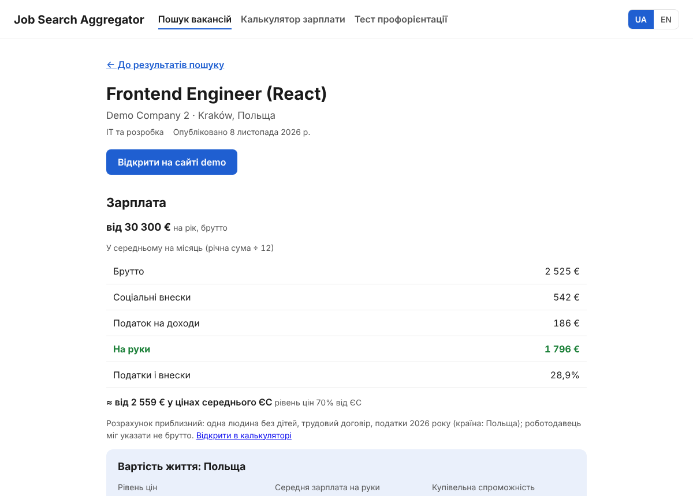
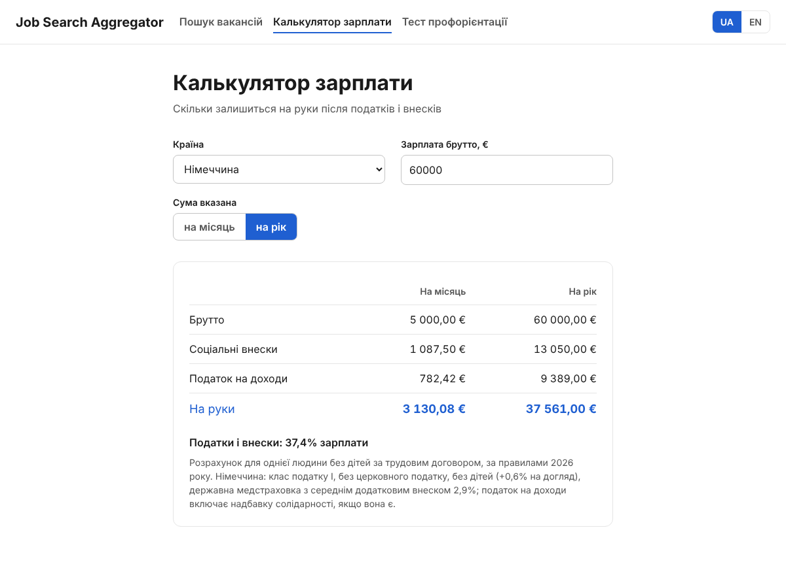

# Job Search Aggregator — frontend

React site for the project: EU vacancies with **take-home pay** and **cost of living**,
a gross → net salary calculator for all 27 EU countries and a career test.
The API is the FastAPI backend in [`../backend`](../backend) (see its README).

[Українською / по-русски — README.ru.md](README.ru.md)

| Search | Vacancy |
|---|---|
|  |  |
| **Calculator** | **Career test result** |
|  |  |

## What is on the site

| Page | Address | What it does |
|---|---|---|
| Home | `/` | Two entry points: search and the career test |
| Job search | `/search?country=PL&industry=it&q=python&page=2` | Country, industry, keyword; filters live in the address. Cards show gross pay, take-home per month by the country's taxes and the same amount at average EU prices. Cost-of-living block for the chosen country |
| Vacancy | `/vacancies/:id?country=PL` | Gross → net table (min/max), cost of living, description cleaned with DOMPurify, links to the sources |
| Calculator | `/calculator?country=DE&gross=60000&period=year&currency=EUR` | Gross → net for 27 EU countries, 2026 rules, local currency or euro |
| Career test | `/career-test` | 30 statements, RIASEC model (John Holland), one per screen |
| Test result | `/career-test/result?r=..&i=..&a=..&s=..&e=..&c=..` | Holland code, all six types, three industries with fresh vacancies |

Languages: Ukrainian (default) and English, switch in the header.

## Run locally

Requires Node.js 22.12+ (24 LTS recommended).

```bash
cd frontend
npm install
cp .env.example .env     # optional: only if the API is not on http://localhost:8000/api/v1
npm run dev              # http://localhost:5173
```

The backend must be running for search, vacancies and the test result vacancies
(`docker compose up --build` in the repository root, or see `backend/README.md`).
Without it those pages show an error with a «Try again» button; the calculator
and the test work without the backend.

| Command | What it does |
|---|---|
| `npm run dev` | Development server with hot reload |
| `npm test` | Tests (Vitest + React Testing Library), watch mode; `npm test -- --run` runs once |
| `npm run lint` | oxlint |
| `npm run build` | Production build to `dist/` |
| `npm run preview` | Serve `dist/` locally |

## Settings

| Variable | Default | Meaning |
|---|---|---|
| `VITE_API_URL` | `http://localhost:8000/api/v1` | Backend API address. Read at **build** time: rebuild after changing it |

## Deploy

The build is static files, so any static host works if it sends `index.html` for unknown
paths (single-page app). A ready image with nginx:

```bash
cd frontend
docker build --build-arg VITE_API_URL=https://api.example.com/api/v1 -t jsa-frontend .
docker run -p 3000:80 jsa-frontend          # http://localhost:3000
```

`nginx.conf` sends `index.html` for site paths and caches hashed files in `/assets/` for a year.

To run it next to the backend, add a service to the root `docker-compose.yml`:

```yaml
  frontend:
    build:
      context: ./frontend
      args:
        VITE_API_URL: http://localhost:8000/api/v1
    ports:
      - "3000:80"
    depends_on:
      - backend
```

The backend must allow the site's origin: `CORS_ORIGINS` (http://localhost:3000 is allowed
by default; add the real domain in production).

CI: `.github/workflows/frontend.yml` runs lint, tests and the build on every push that touches `frontend/`.

## How the numbers are calculated

- **Take-home pay** — `src/salary/calculateNet.js` with one rules file per country in
  `src/salary/rules/` (sources and assumptions are at the top of each file). Assumptions: single,
  no children, employment contract, tax resident, 2026 rules. Countries outside the euro are
  calculated in local currency at fixed ECB rates (`src/salary/exchangeRates.js`, 6 Nov 2026).
- **Vacancy salaries** are annual gross in euro from the backend; per month = year ÷ 12.
  Only ~6% of vacancies have a salary.
- **At average EU prices** = take-home ÷ (Eurostat price level index / 100), from `/cost-of-living`.
- **Career test** — `src/careerTest/`: questions in `questions.json`, scoring and the
  type → industry table in `riasec.js`.

## Project structure

```
src/
  api/          client.js (all API calls), useCostOfLiving.js
  careerTest/   questions.json, riasec.js (scoring, industry match)
  components/   Header, Footer, VacancyCard, CostOfLiving, IndustryVacancies…
  i18n/         uk.json, en.json, index.js
  pages/        one file per page + its CSS module and tests
  salary/       calculator engine, rules per country, exchange rates
  test/         mockServer.js — fake backend for tests
  vacancies/    vacancyMoney.js — gross → net → EU prices for a vacancy
```

## Known limits (backend requests)

- Search takes one industry at a time, so the test result makes one request per industry.
- No sorting or filter by salary; no exchange-rate endpoint (rates are fixed in the frontend).
