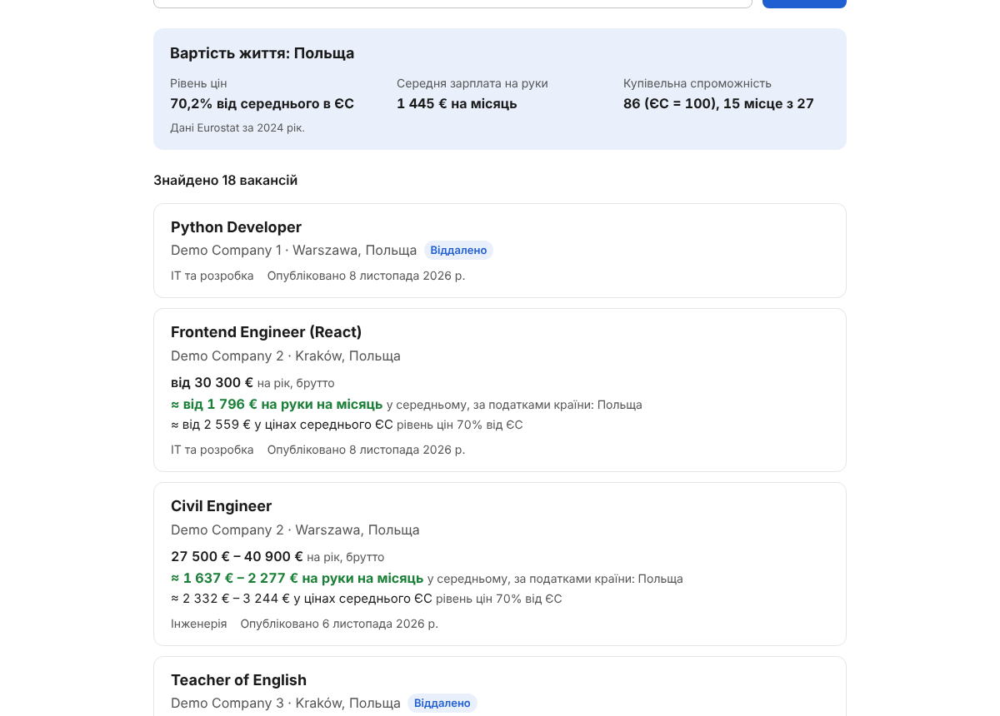

# Job Search Aggregator — фронтенд

Сайт проекта на React: вакансии в ЕС с суммой **«на руки»** и **стоимостью жизни**,
калькулятор «брутто → на руки» для всех 27 стран ЕС и тест профориентации.
API — бэкенд на FastAPI в [`../backend`](../backend).



## Страницы

| Страница | Адрес | Что делает |
|---|---|---|
| Главная | `/` | Кнопки «Шукати вакансії» и «Пройти тест профорієнтації» |
| Поиск | `/search?country=PL&industry=it&q=python&page=2` | Страна, галузь, слово; фильтры в адресе. В карточке: брутто, «на руки» в месяц по налогам страны, та же сумма в ценах среднего ЕС. Блок «Вартість життя» для выбранной страны |
| Вакансия | `/vacancies/:id?country=PL` | Таблица «брутто → на руки» (мин./макс.), стоимость жизни, описание (очищено DOMPurify), ссылки на источники |
| Калькулятор | `/calculator?country=DE&gross=60000&period=year&currency=EUR` | 27 стран, правила 2026 года, местная валюта или евро |
| Тест | `/career-test` | 30 утверждений, модель RIASEC (Джон Голланд), по одному на экране |
| Результат | `/career-test/result?r=..&i=..` | Код Голланда, шесть типов, три галузі со свежими вакансиями |

Языки: украинский (по умолчанию) и английский.

## Запуск

Нужен Node.js 22.12+ (лучше 24 LTS).

```bash
cd frontend
npm install
npm run dev        # http://localhost:5173
```

Для поиска нужен запущенный бэкенд (`docker compose up --build` в корне или `backend/README.ru.md`).
Без него эти страницы показывают ошибку и кнопку «Спробувати ще раз»; калькулятор и тест работают и так.

- `npm test` — тесты (`npm test -- --run` — один прогон), `npm run lint` — проверка кода, `npm run build` — сборка в `dist/`.
- Адрес API — переменная `VITE_API_URL` (пример в `.env.example`), по умолчанию `http://localhost:8000/api/v1`. Читается при сборке.

## Деплой

Сборка — обычные файлы; подойдёт любой хостинг статики, который на неизвестные адреса отдаёт `index.html`.
Готовый образ с nginx:

```bash
cd frontend
docker build --build-arg VITE_API_URL=https://api.example.com/api/v1 -t jsa-frontend .
docker run -p 3000:80 jsa-frontend
```

Бэкенду нужно разрешить адрес сайта в `CORS_ORIGINS`. Пример сервиса для `docker-compose.yml` и подробности — в README.md.
CI: `.github/workflows/frontend.yml` — проверка кода, тесты и сборка при каждом push в `frontend/`.

## Как считаются суммы

- «На руки» — `src/salary/calculateNet.js` и правила стран в `src/salary/rules/` (источники и допущения — в начале каждого файла): один человек без детей, трудовой договор, правила 2026 года.
- Зарплата вакансии — годовое брутто в евро от бэкенда; в месяц = год ÷ 12. Зарплата есть примерно у 6% вакансий.
- «В ценах среднего ЕС» = на руки ÷ (уровень цен Eurostat / 100).
- Тест — `src/careerTest/`: вопросы в `questions.json`, подсчёт и таблица «тип → галузь» в `riasec.js`.
